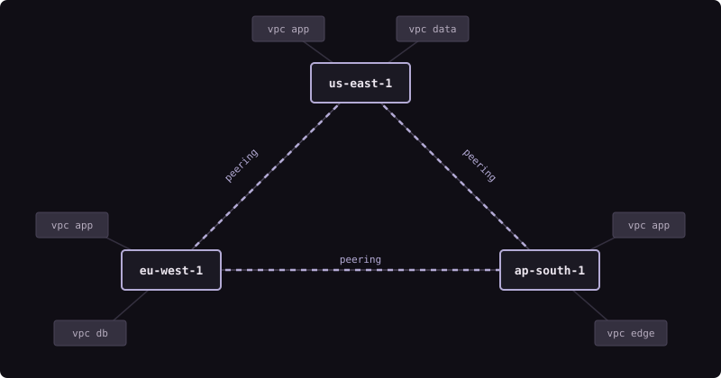
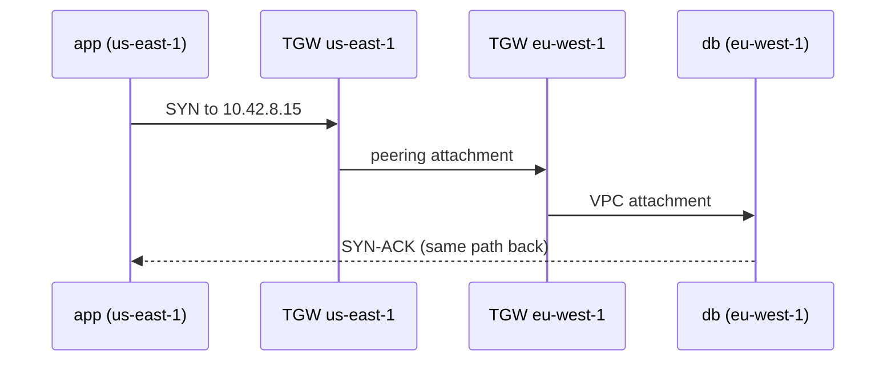

+++
# DESIGN FIXTURE: synthetic content for checking the layout. Draft only; never publish.
# Preview with:  hugo server -D
draft = true
date = '2026-11-18T23:10:00-05:00'
title = 'Designing a multi-region Transit Gateway mesh without losing your weekend'
description = 'A worked example of every element a post can carry: code, terminal output, diagrams, tables, callouts and footnotes.'
tags = ['aws', 'networking', 'terraform']
# Placeholder: shows the optional "listening to" strip.
listening = 'Artist – Track title from an album with a long name'
+++

> [!NOTE] Design fixture
> This post is synthetic sample content used to check the site's design. It isn't a real write-up.

Most multi-region AWS networks start as two VPCs and a peering connection, and stay that way until the third region shows up. Then the route tables multiply, someone draws the topology on a whiteboard, and nobody can say for sure which path a packet takes from `us-east-1` to `eu-west-1`.

This walk-through builds a hub-and-spoke mesh with Transit Gateway[^tgw], peers the hubs across regions, and keeps the whole thing in Terraform so the next region is a pull request, not a project.

## The shape we're building

Each region gets one Transit Gateway. Workload VPCs attach to their regional hub, and hubs peer with each other. Routing between regions happens only at the hubs.



The same thing as a sequence, for one request crossing regions:



## Terraform for one hub

The module takes a region, a CIDR plan and a list of VPCs to attach. Everything else is derived.

```hcl {title="modules/hub/main.tf"}
resource "aws_ec2_transit_gateway" "hub" {
  description                     = "hub-${var.region}"
  amazon_side_asn                 = var.asn
  default_route_table_association = "disable"
  default_route_table_propagation = "disable"

  tags = {
    Name = "hub-${var.region}"
  }
}

resource "aws_ec2_transit_gateway_vpc_attachment" "spoke" {
  for_each           = var.spokes
  transit_gateway_id = aws_ec2_transit_gateway.hub.id
  vpc_id             = each.value.vpc_id
  subnet_ids         = each.value.subnet_ids
}
```

Adding the third region is one change to the hub list:

```diff
 module "hub" {
   for_each = toset([
     "us-east-1",
     "eu-west-1",
+    "ap-southeast-2",
   ])
-  asn_base = 64512
+  asn_base = 64600
 }
```

### Checking the routes

After an apply, ask each hub what it thinks the world looks like:

```console
$ aws ec2 search-transit-gateway-routes \
    --transit-gateway-route-table-id tgw-rtb-0a1b2c3d \
    --filters Name=state,Values=active
10.10.0.0/16   attachment  vpc-0aa1   active
10.20.0.0/16   attachment  vpc-0bb2   active
10.42.0.0/16   peering     tgw-attach-0cc3   active
```

A Go helper I use to diff the expected and actual route sets:

```go
func diffRoutes(want, got map[string]string) (missing, extra []string) {
	for cidr, target := range want {
		if got[cidr] != target {
			missing = append(missing, fmt.Sprintf("%s -> %s", cidr, target))
		}
	}
	for cidr := range got {
		if _, ok := want[cidr]; !ok {
			extra = append(extra, cidr)
		}
	}
	return missing, extra
}
```

## Costs and limits

| Item | Per hub | Three regions | Notes |
|:-----|-------:|-------------:|:------|
| TGW attachment-hour | $0.05 | $0.45/hr | 3 attachments per hub |
| Data processed | $0.02/GB | varies | charged at the sending TGW |
| Peering attachments | 2 | 3 total | full mesh of hubs |
| Route table entries | 10,000 | — | soft limit, raise early |

> [!WARNING]
> Peering attachments don't propagate routes. Every cross-region route is static, so a new CIDR means a route change in **every** hub.

> [!TIP] TL;DR
> One hub per region, static routes between hubs, and a Terraform module that makes the next region boring.

## When it goes wrong

The first failure is usually silent: health checks pass, small requests work, and large responses hang. That's almost always MTU.

```log
2026-11-12T02:40:11Z WARN  tls: handshake slow peer=10.42.8.15 rtt=1.9s
2026-11-12T02:40:14Z ERROR tls: handshake timeout peer=10.42.8.15
2026-11-12T02:40:14Z INFO  retrying with backoff=2s
```

> Every network problem is a DNS problem until it's an MTU problem.

> [!CAUTION]
> Don't block all ICMP in security groups. Path MTU discovery needs "fragmentation needed" messages to get through.

> [!IMPORTANT]
> Inter-region data transfer is billed on top of TGW data processing.

### A short checklist

1. Confirm the path MTU with `ping -M do -s 1472`.
2. Check the security groups allow ICMP type 3, code 4.
3. Clamp MSS on the tunnel if you can't fix the path.

- [x] Hubs deployed in three regions
- [x] Peering accepted
- [ ] Route tables reviewed by someone who isn't me

Press <kbd>Ctrl</kbd> + <kbd>C</kbd> to stop a runaway `ping`.

Transit Gateway
: A regional router for VPCs and VPNs.

Peering attachment
: A link between two Transit Gateways, usually in different regions.

[^tgw]: Transit Gateway is AWS's managed regional router. The [docs](https://docs.aws.amazon.com/vpc/latest/tgw/) are worth reading end to end once.
